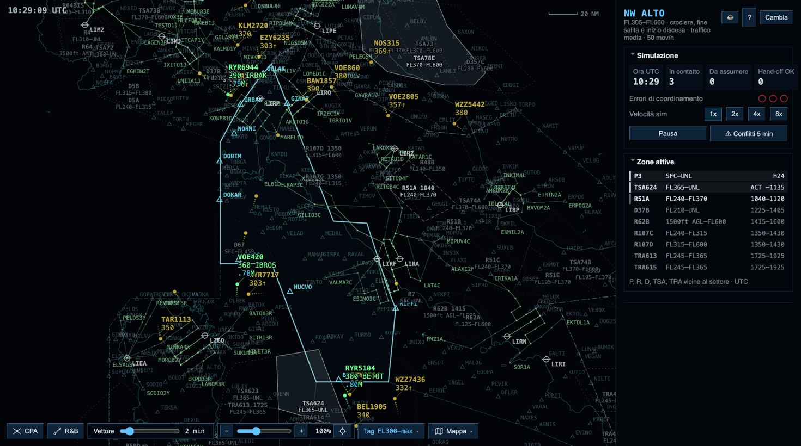
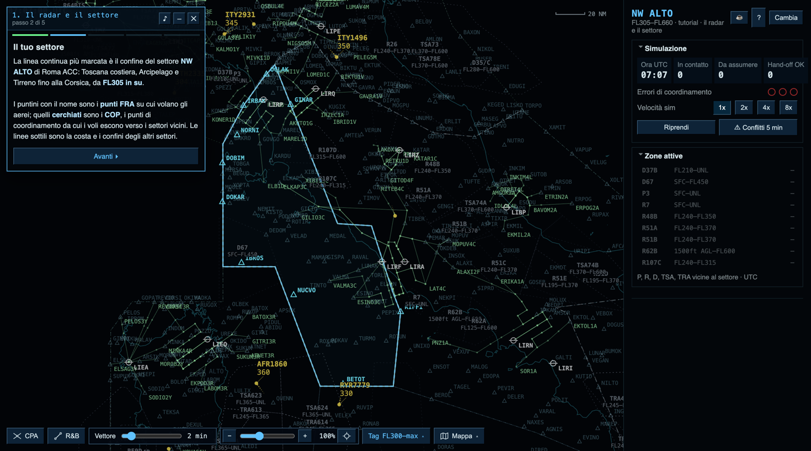

<div align="center">

# ACS Simulator

**Area Control Simulator — il controllo del traffico aereo d'area, Roma ACC e Milano ACC**



</div>

## Che cos'è

ACS Simulator mette davanti a un radar di **controllo d'area**: il mestiere di chi,
da una sala senza finestre, segue gli aerei in rotta fra un aeroporto e l'altro.

Non si fanno atterrare gli aerei. Si prendono in carico i voli che entrano nel
proprio settore, li si tiene separati — **5 miglia o 1000 piedi**, mai meno — e
li si consegna al settore successivo nel punto e al livello concordati. Nel
frattempo arrivano temporali da aggirare, zone militari che si attivano, piloti
che chiedono un livello più alto e, ogni tanto, qualcuno che dichiara emergenza.

Tutto quello che si vede è ricostruito su dati reali: i **punti FRA** e i
confini dalla carta dell'AIP Italia, la **settorizzazione** di Roma ACC e Milano
ACC dalle procedure pubbliche di VATSIM Italia, le **SID e STAR** degli
aeroporti italiani, il traffico generato sui flussi veri fra aeroporti con
profili di salita e discesa calcolati sulle prestazioni di ogni tipo di
aeromobile.

## Gioca online

**[→ Gioca nel browser](https://acs-simulator.github.io/acs-simulator/)**, senza
installare niente. È la stessa simulazione del programma da scaricare, con il
tutorial incluso. Serve un computer con mouse o trackpad e uno schermo di almeno
1100×700 pixel: su telefono e tablet il radar non è ancora utilizzabile.

## Scarica

**[→ Scarica l'ultima versione](https://github.com/acs-simulator/acs-simulator/releases/latest)** per macOS, Windows o Linux.

| Sistema | File | Note |
|---|---|---|
| macOS 11 o successivo | `ACS.Simulator-x.y.z-arm64.dmg` (Apple Silicon) o `-x64.dmg` (Intel) | vedi sotto |
| Windows 10 o successivo | `ACS.Simulator-x.y.z-setup.exe` | vedi sotto |
| Linux | `ACS.Simulator-x.y.z.AppImage` o `.deb` | rendi l'AppImage eseguibile con `chmod +x` |

Servono circa 300 MB di spazio e uno schermo di almeno 1100×700. Nessuna
connessione a internet, nessun account, nessun dato raccolto.

### Al primo avvio

L'applicazione non è firmata con un certificato di sviluppatore (costa 99 $
l'anno su Apple e un centinaio su Windows), quindi i due sistemi avvisano che
l'autore non è "verificato". Non è un virus: è il prezzo di un progetto
indipendente e gratuito.

- **macOS** — trascina l'app in *Applicazioni*, poi aprila la prima volta con
  **clic destro → Apri** e conferma. Dalla seconda volta basta un doppio clic.
  Se compare "l'app è danneggiata", apri il Terminale e dai
  `xattr -dr com.apple.quarantine "/Applications/ACS Simulator.app"`.
- **Windows** — alla schermata blu di SmartScreen premi **Ulteriori
  informazioni → Esegui comunque**.

## Come si impara

<div align="center">



</div>

Dentro c'è un **tutorial guidato**: dieci lezioni da una decina di minuti che
partono da zero e arrivano a un turno completo. Non è un filmato — si controlla
davvero, sulla simulazione vera, ma ogni lezione prepara la situazione che
serve (un volo da prendere in carico, due traiettorie che si incrociano, una
zona che si attiva) e ti segue passo per passo. Nessun errore chiude la partita
finché sei lì dentro.

Lo trovi in cima alla colonna dei settori, nella schermata iniziale. Se preferisci
leggere, le regole sono scritte nella stessa schermata e il tasto **H** apre in
ogni momento il riepilogo dei comandi.

## Cosa c'è dentro

- **Due centri di controllo**: Roma ACC (undici settori su tre strati, dalla
  Toscana alla Sicilia, Sardegna compresa) e Milano ACC.
- **Traffico realistico**: flussi fra aeroporti veri pesati sui movimenti
  commerciali, livelli di crociera coerenti con la distanza, regola
  semicircolare italiana, prestazioni per tipo di aeromobile.
- **Difficoltà regolabile**: da cinque a dieci voli in contatto insieme, con il
  settore che resta carico per tutta la sessione.
- **Conflitti costruiti su misura**: il settore vicino ti consegna voli che
  incrociano i tuoi, con un tempo di reazione tarato sulla difficoltà.
- **Meteo**: fronti temporaleschi che si spostano e crescono, turbolenza in aria
  chiara scoperta dai riporti dei piloti, deviazioni richieste e autorizzate.
- **Zone riservate** P, R, D, TSA e TRA con orari di attivazione, allarmi di
  prossimità e previsione d'ingresso.
- **Emergenze**: avarie motore, depressurizzazioni, malori a bordo, avarie
  radio, con le priorità e il coordinamento previsti dalle procedure ATS.
- **Etichette integrate** sul modello di quelle reali, con le istruzioni che si
  impartiscono cliccando i campi del tag.

## Per chi sviluppa

```bash
npm install
```

| Comando | Che cosa fa |
|---|---|
| `npm start` | avvia il simulatore |
| `npm test` | controlli di pacchetto e bilanciamento della simulazione |
| `npm run site` | assembla il sito (presentazione + versione nel browser) in `_site/` |
| `npm run dist` | pacchetti per il sistema corrente, in `dist/` |
| `npm run dist:win` | installer per Windows (richiede Windows, o la via automatica qui sotto) |

I pacchetti per i tre sistemi si costruiscono anche senza avere i tre computer:
pubblica un tag di versione e ci pensa GitHub Actions (`.github/workflows/pacchetti.yml`).
Il sito, con la versione giocabile nel browser, si aggiorna da solo a ogni push su `main`
(`.github/workflows/sito.yml`); nelle impostazioni del repository, *Pages → Source*
va impostato su **GitHub Actions**.

Il **banco di prova** fa girare la simulazione senza interfaccia, con un controllore
automatico, e misura carico, offerte orarie, allarmi e tempi di calcolo: serve a
controllare il bilanciamento del traffico su tutti i settori di un ACC o su alcuni.

```bash
node tools/harness.mjs roma
```

```bash
HOURS=8 DIFF=difficile node tools/harness.mjs roma NWB
```

Le schermate di `docs/` e l'icona si rigenerano da sole, la prima
dall'applicazione vera:

```bash
npx electron tools/screenshot.mjs
```

```bash
python3 build/make-icon.py
```

L'anteprima dei link condivisi (`site/img/social.jpg`), il video verticale per i social e
l'immagine quadrata (in `dist/promo/`) si rifanno dal simulatore vero con:

```bash
npx electron tools/promo-media.mjs
```

Il codice è in `renderer/`: `sim.js` è il motore (traffico, coordinamento,
conflitti, zone, meteo, emergenze), `radar.js` disegna, `app.js` tiene insieme
interfaccia ed eventi, `tutorial.js` è la modalità guidata. Non c'è nessun passo
di compilazione: sono moduli ES caricati direttamente dalla pagina.

## Dati, fonti e avvertenza

> **ACS Simulator non ha alcun valore operativo.** È una simulazione didattica e
> ricreativa. I dati aeronautici sono una ricostruzione parziale, non aggiornata
> agli ultimi cicli AIRAC, e non rappresentano le procedure in vigore: non
> possono essere usati per la navigazione aerea né per l'addestramento
> professionale. Il simulatore non è prodotto, approvato né sostenuto da
> ENAV S.p.A., da IVAO o da VATSIM.

Le fonti di ogni dato — AIP Italia di ENAV, settore Aurora di IVAO Italia,
mappe TopSky e SOP di VATSIM Italia — sono elencate per esteso in **[CREDITI.md](CREDITI.md)**.

## Segnalazioni

Un errore, un dato sbagliato, un settore che non torna? Apri una
[segnalazione](https://github.com/acs-simulator/acs-simulator/issues): serve il settore, la difficoltà e, se puoi, come ripetere il problema.

## Licenza

Copyright © 2026 ACS Simulator. **Tutti i diritti riservati.**

ACS Simulator è gratuito: puoi scaricarlo, usarlo su quanti dispositivi vuoi,
mostrarlo, trasmetterlo in diretta e farci video. Non puoi ridistribuirlo,
venderlo o pubblicarne versioni modificate. Il testo completo è in
**[LICENSE](LICENSE)**.

## Sostieni il progetto

ACS Simulator è scritto nel tempo libero da una persona sola e resterà gratuito.
Se ti diverte o ti è utile, puoi **offrire un caffè** a chi lo sviluppa: il
pulsante è nella schermata iniziale, sotto *Informazioni*. È il modo più diretto
per far crescere i settori, le procedure e le lezioni.
